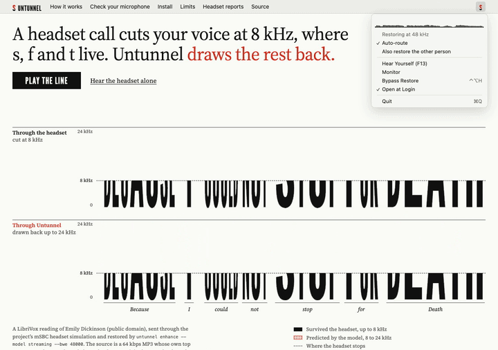

# Untunnel

Your voice goes thin when you take a call on your headset.

Untunnel is an experimental attempt to repair that sound on a Mac. Try it on a recording and compare the result with the original.

<picture>
  <source media="(prefers-reduced-motion: reduce)" srcset="docs/hero.png">
  
</picture>

The demo uses a reading passed through a simulated headset. The red band is predicted, not recovered from the original voice.

**[Hear the demo](https://untunnel.intesarjawad.com/)**.

File restoration works. Live calls on real headsets are unverified, and no installable release is published yet. Testing the call path requires installing a driver with administrator rights.

## Try it on a file

Xcode with Swift 6.2 or later, uv, make, Git and gitleaks. Apple silicon, macOS 15 or later.

```sh
make setup
swift run untunnel download
swift run untunnel enhance fixtures/narrowband/speech.wav out.wav --model streaming --bwe 48000
```

```text
Wrote out.wav: streaming model, 48000 Hz, 77760 samples.
```

The download shows its size first and keeps the files only if their SHA-256 matches. `make run` starts the app and `make check` runs every check. The offline model, the headset report and the other commands are in [how it works](docs/how-it-works.md) and [CONTRIBUTING.md](CONTRIBUTING.md).

## Why a headset call sounds tinny

A Bluetooth headset plays music at a high sample rate. When any app opens its microphone, macOS switches it to the call profile, which carries your voice at 16 kHz or 8 kHz. Everything above half that rate is gone, and consonants such as s, f and t live there.

Untunnel runs a speech restoration model on that narrow signal and predicts the missing band from what survived. A virtual microphone, "Untunnel Microphone", carries the result into Zoom, Meet or FaceTime.

The demo at the top is a LibriVox reading, passed through the project's headset simulation and then through Untunnel. Letter height is frequency up to 24 kHz.

## What works today

- **Restoring a file.** `untunnel enhance` runs either model on a recording.
- **Hear Yourself.** The app records your headset and plays the restored take beside the original.
- **The tools around it:** the benchmark, `doctor`, the driver build and `uninstall`.

## What has not run yet

- **A real call.** The outgoing path is wired end to end: headset capture, resampling and drift control, the model and the virtual microphone, with a fallback to the raw microphone when a stage fails. It needs the driver installed with administrator rights and a headset to test with.
- **The other person's voice.** Wired behind a menu toggle, off by default and headphones only. It needs macOS's system-audio permission.
- **A release.** None is published, so the install commands at the end do not work yet.

## The models

Both are written in Swift from the published architecture and held to the publisher's own code by parity tests.

- **Streaming** ([ADR-0010](docs/adr/0010-real-time-model-architecture.md)): NVIDIA's Real-time RE-USE, with a 40 ms window and a 20 ms hop. This is the live path.
  <!-- number: 40 ms window and 20 ms hop, docs/adr/0010-real-time-model-architecture.md "Transform" -->
- **Offline** ([ADR-0013](docs/adr/0013-offline-model-architecture.md)): NVIDIA-NemotronLabs-RE-USE. Thirty blocks that read a whole chunk at once, so it works on files only.
  <!-- number: 30 blocks, docs/adr/0013-offline-model-architecture.md "The published model" -->

Against the publisher's stored outputs, the Swift streaming model reaches 119.71 to 121.97 dB SNR on 5 goldens and the offline model 92.21 to 104.17 dB on 4. From raw samples the streaming model reaches 56.88 to 63.98 dB. Getting there meant building the Hann window in float32, as the publisher does: its tiny asymmetry decides phase signs near plus or minus pi. Full tables: [docs/bench.md](docs/bench.md).
<!-- number: 5 streaming goldens, 119.71 to 121.97 dB, docs/bench.md "Golden parity" column SNR dB -->
<!-- number: 4 offline goldens, 92.21 to 104.17 dB, docs/bench.md "Offline golden parity" column SNR dB -->
<!-- number: 56.88 to 63.98 dB, docs/bench.md "Golden parity" columns From samples -->

## Limits

- The missing band is predicted, not recovered.
- The delay a call adds is not measured. The streaming model alone adds 40 ms plus 20 ms per look-ahead frame.
  <!-- number: 40 ms window plus 20 ms per look-ahead frame, docs/adr/0010-real-time-model-architecture.md "Consequences" -->
- Speech only. The model suppresses what is not speech, and Untunnel does not claim to remove room noise.
- Apple silicon and macOS 15 or later only.
- The app and driver are signed ad hoc and not notarised.

The full list is in [docs/limits.md](docs/limits.md).

## Licences

The code is MIT. The weights are not included and keep their own licences ([NOTICE](NOTICE)). The streaming weights, the live path, are under NVIDIA's non-commercial licence, so a build that restores a call with them is for non-commercial use whatever licence the Swift code has. Details: [docs/licences.md](docs/licences.md).

## Where it fits

Apple's Voice Isolation, Krisp and NVIDIA Broadcast remove noise. Untunnel targets a different loss: the band a headset never sent. Hush AI and ReuseMic already work as virtual microphones for the same streaming model. Untunnel has not been compared with any of these by ear or by measurement: [what each one does](docs/alternatives.md).

## Install and uninstall

Planned for the first release; neither line works before it exists. Read [the install script](site/install.sh) first.

```sh
curl -fsSL https://untunnel.intesarjawad.com/install.sh | sh
brew install intesarjawad/tap/untunnel
```

`untunnel uninstall --dry-run` lists the four paths it would remove before it touches anything: [what Untunnel writes to your system](docs/uninstall.md).

## Contributing and credits

[CONTRIBUTING.md](CONTRIBUTING.md), [SECURITY.md](SECURITY.md) and the [code of conduct](CODE_OF_CONDUCT.md). Cite it with [CITATION.cff](CITATION.cff).

Credit to the NVIDIA RE-USE authors for the models and papers, and to the Mamba authors for the recurrence (Apache-2.0, implemented from its equations; no source copied).
