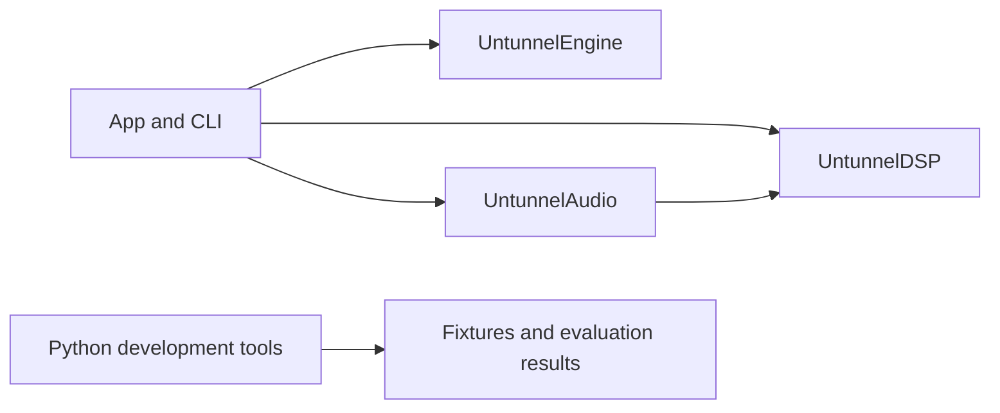

# Architecture

`UntunnelEngine` is a reusable Swift library. Its pure computation has no Core Audio,
filesystem, network, clock or UI access. `UntunnelDSP` owns resampling and sample rings.
`UntunnelAudio` owns device integration. The executable composes those modules.
Only the package boundaries and the engine's tier value are implemented in this scaffold.

The planned pipeline uses one inference thread per restoration stream. Audio callbacks
only copy samples between preallocated rings. Inference runs outside callbacks, with
preallocated state owned by a single pipeline thread. Device integration and scheduling
are not implemented yet.

Python lives in `tools/` and is never a user runtime dependency. The base dependency set
contains numeric and audio-file tools. The `eval`, `site` and `dev` groups isolate evaluation,
static-site testing and contributor tooling. The universal lock includes all groups.

Tool paths resolve from each source file to the nearest parent containing `Package.swift`.
This works in source archives without `.git` and keeps output independent of the working
directory. See [ADR-0002](adr/0002-native-swift-engine.md) for the native-engine decision
and scaffold pin verification.
