# How Untunnel works

This page follows your voice from the headset to the call app and names the file that does each
step, so you can change any of them. Every constant quoted here is read from the source file
named next to it.

## What runs today

The restoration engine, the audio plug-in and each stage of the live microphone path below are
built and covered by tests, and the menu bar app connects the outgoing stages into one path that
falls back to the raw microphone when a stage fails. That path has not yet run on a real call:
it needs the plug-in installed with administrator rights and a headset test. The app's Hear
Yourself window records the headset and plays the restored take beside the original. The
incoming path is wired the same way: the menu toggle starts a process tap on the app reading
the microphone, a second pipeline restores the tapped audio and plays it on the headphones, and
tap and aggregate device are destroyed on every exit. Fake-process and fake-device tests cover
each rule; the path has not run on a real call, and neither has the system-audio permission
prompt. The rest of this page describes the path the stages form.

## Why a Bluetooth headset sounds narrow

A Bluetooth headset plays music over a high-rate stereo profile. As soon as any app opens its
microphone, macOS switches it to the hands-free call profile, which carries the voice both ways
at a low sample rate: 16 kHz on a wideband (mSBC) link, 8 kHz on a narrowband one. A signal
sampled at a rate cannot hold anything above half that rate, so a wideband call loses everything
above 8 kHz and a narrowband call everything above 4 kHz. Consonants such as s, f and t live up
there, which is why the voice sounds muffled.

`tools/src/untunnel_tools/eval/simulate_hfp.py` reproduces both links (`MSBC_RATE`,
`MULAW_RATE`) for the evaluation, and `HeadsetCallMode.ceilingHz` in
`Sources/UntunnelAudio/HeadsetOutput.swift` is the rate above which an output is treated as out
of call mode.

## What the model restores

The model is an independent Swift implementation of NVIDIA's Real-time RE-USE network
(`Sources/UntunnelEngine/Realtime`; [ADR-0010](adr/0010-real-time-model-architecture.md)
records the architecture and where each fact was read). It reads the spectrum of the narrow signal and predicts the
magnitude and phase of every frequency bin up to half the tier rate. The missing band is
predicted from what survived, not recovered: the headset never sent it, so the model writes
what speech with that lower band usually has above it.

One hop through `RealtimeRestorer.swift`:

1. `StreamingSTFT` cuts a frame twice the hop long (`Tier.streamingHopMilliseconds` is the hop),
   centred with reflection padding, and turns it into `log1p` magnitudes and `atan2` phases.
2. `RealtimeEncoder` turns the two columns into 64-wide features: a first layer chosen by the
   tier's look-ahead, a dense block (`DenseStack.swift`) whose four layers each read every
   earlier layer's output further back in time, and a layer that halves the frequency axis.
3. `RealtimeBlock` runs Mamba recurrences (`SelectiveScan.swift`): one per bin along time,
   which carries its state from hop to hop, then one up and one down the bins of the current
   frame. The tier's exit layer decides how many blocks run; each depth has its own decoder
   pair, so a cheaper tier stops early instead of loading a smaller model.
4. `RealtimeDecoder` produces the magnitude and the phase for that depth. A frame whose
   magnitudes are mostly non-positive is cleared rather than passed on.
5. `StreamingISTFT` overlap-adds the frame back into one hop of samples.

Each layer keeps its state between hops, so streaming gives the same result as running the
whole signal at once. `IntermediateParity` and `GoldenParity` in `Tests/UntunnelEngineTests`
compare every module and the final waveform with outputs of the publisher's own code, stored
under `fixtures/model`; they run wherever `untunnel download` has fetched the checkpoint.

The recurrence, the activations, the normalisation and the matrix product are C kernels
(`Sources/UntunnelKernels`); the product runs on the processor's matrix unit where it has
one and allocates nothing. Each matrix product of a frame runs on the calling thread, and
everything between two products is shared with a fixed pool of worker threads
(`WorkerPool.swift`) without locks or allocation
([ADR-0011](adr/0011-engine-threads-and-kernels.md),
[ADR-0012](adr/0012-frame-schedule.md)). `docs/bench.md` names the tiers that fit the
latency budget on the machine it was measured on.

`Offline/OfflineRestorer.swift` is the file-mode path, run in chunks by
`ChunkedInference.swift`. It implements the published file-mode model, whose normalisations and
bidirectional blocks read a whole chunk at once, and is held to the publisher's output the same
way ([ADR-0013](adr/0013-offline-model-architecture.md)).

## The microphone path

```mermaid
flowchart LR
    Headset[Headset input] -->|IOProc| InRing[Input ring]
    InRing --> Pipe[Pipeline thread]
    Pipe -->|resample to tier rate| Engine[RealtimeRestorer]
    Engine -->|crossfade with bypass, resample| OutRing[Output ring]
    OutRing -->|drift resampler, IOProc| Feed[Untunnel Feed]
    Feed --> DriverRing[Plug-in ring]
    DriverRing --> Mic[Untunnel Microphone]
    Mic --> Call[Call app]
```



1. `InputCapture` (`Sources/UntunnelAudio/InputCapture.swift`) opens the headset by its UID
   with an IOProc. The callback only copies mono samples into a `RingBuffer` and stamps the host
   time of each completed hop for the latency meter.
2. `Pipeline` (`Pipeline.swift`) wakes on a semaphore, reads one hop, and converts it from the
   device rate to the tier rate with `PolyphaseResampler`, a Kaiser-windowed sinc filter
   designed once for the fixed rate pair. Frames the resampler leaves at a hop boundary carry
   over to the next hop.
3. The restorer runs one hop. Bypass is read once per hop and switched with an equal-power
   crossfade (`Pipeline.crossfadeMilliseconds`), so a toggle never clicks or splits a hop.
4. A second `PolyphaseResampler` converts the tier rate to the virtual device's rate and the
   hop goes into the output ring.
5. `VirtualMicOutput` (`VirtualMicOutput.swift`) feeds the hidden "Untunnel Feed" device from
   its IOProc. The headset and the virtual device run on different clocks, so
   `DriftResampler` (`Sources/UntunnelDSP/DriftResampler.swift`) reads the ring at a ratio a PI
   controller keeps within ±0.5 % of 1, holding the ring about one and a half hops full
   ([ADR-0006](adr/0006-clock-drift.md)). A hop it cannot fill is sent as silence and counted.
6. The plug-in (`driver/Untunnel.c`, logic in `Sources/UntunnelDriverCore`) indexes one ring
   by its clock's sample time: what the feed writes for time T is what "Untunnel Microphone"
   returns to a reader at time T, and anything not written reads as silence
   ([ADR-0001](adr/0001-virtual-microphone.md)).

When the headset disappears mid-call, `ReconnectRecovery` stops capture, clears the restorer's
state and waits for the same UID. Meanwhile the pipeline thread's semaphore times out
(`Pipeline.heartbeatMilliseconds`) and it writes a silence hop each time, so the call app keeps
a live microphone and the hop counter keeps moving.

## The latency budget

The delay the path adds is the sum of:

- the headset's own input latency and the virtual device's output latency, as Core Audio
  reports them (converter latency, safety offset and stream latency, read in `LatencyMeter`);
- one hop of accumulation before the pipeline can run;
- the engine: one frame (two hops) plus the look-ahead hops, computed as
  `RealtimeRestorer.latencySamples`; the tiers in `Bench.swift` use a look-ahead of zero or one;
- the delay of the two polyphase filters;
- the hops waiting in the output ring, which the drift controller holds near one and a half.

`LatencyMeter` (`Sources/UntunnelAudio/LatencyMeter.swift`) measures the middle three directly:
it pairs each hop's input completion stamp with the output pull that delivers it, keeps a
running median, and adds the device latencies. The Monitor window shows that number. Published delay
figures come only from `uv run --project tools python -m untunnel_tools.measure.latency`.

## Engaging, routing and the failsafe

- **Auto-engage** ([ADR-0003](adr/0003-auto-engage.md)): `ClientWatcher` watches Core Audio's
  process list and opens the headset input only while another app is running input on Untunnel
  Microphone, so the headset stays in its high-rate profile when nobody listens.
- **Auto-route** ([ADR-0008](adr/0008-auto-route.md)): `App/AutoRoute.swift` is a pure state
  machine that follows macOS when it switches the default input to a headset that has just
  connected, and steps aside for any change you make by hand.
- **Failsafe**: the plug-in hides Untunnel Microphone when the app stops writing to the feed
  device for `kLivenessTimeoutNanoseconds` (`driver/Untunnel.c`), so macOS falls back to another
  input. `App/Heartbeat.swift` writes the `'hbt '` property once a second, and only while the
  pipeline's hop counter is moving, microphone permission is granted and the plug-in's checks
  have passed, so a hung app stops the heartbeat too. Built with `make -C driver LIVENESS=clients`, the plug-in uses the app's
  client leaving the feed device as the signal instead.

## The incoming path

"Also restore the other person" taps the call app's output with a Core Audio process tap
(`ProcessTap.swift`): private, muted while tapped so you do not hear the call twice, and grouped
by bundle identifier so a browser call taps the helper process that plays it. `HeadphoneGuard`
(`HeadsetOutput.swift`) allows it only on Bluetooth output, the built-in headphone jack, or a
device you marked as headphones, because restored audio on speakers would reach the call as
echo ([ADR-0005](adr/0005-process-tap-headphones-only.md)). When a USB output is refused, the
menu offers "Treat <name> as headphones", stored by device UID in user defaults; a marked output
offers "<name> is not headphones" to take it back. Built-in speakers, displays and AirPlay are
never offered.

`MicPathController` owns an `IncomingTap`, which follows `ClientWatcher`, the toggle and the
default output. It starts the tap through `IncomingPlayback` (`App/IncomingPath.swift`), which
reads the tap's aggregate device into the same `Pipeline` the microphone uses, with its own model
instance, and plays the result on the current output. Creating the tap mutes the call app, so a
session that fails to start destroys the tap again at once; with no model loaded the raw call
audio plays instead of the restored one. Moving the output to speakers stops playback and the
tap within one device-change callback, and headphones returning starts them again. Tap and
aggregate also stop when the toggle goes off, the call ends, the call app exits, or the app
quits, and `StrayTapSweep` clears an aggregate a killed run left behind before anything else
starts at launch.

## What runs on which thread

| Thread | Work | Rule |
|---|---|---|
| Core Audio IOProcs | `InputCapture`, `VirtualMicOutput`, `HeadsetOutput`, the plug-in's IO | Copy samples and stamp times only: no locks, allocation or logging |
| `untunnel.pipeline`, user-interactive QoS | Resampling, inference, crossfade | All buffers allocated before the thread starts |
| Main | Menu, Monitor, the ten-times-a-second readout (`PipelineStatusMonitor`), the heartbeat timer | Reads the pipeline's atomics, never its buffers |
| Private dispatch queues | `ClientWatcher` process listeners and the release delay | Decisions only |

Rings between the callbacks and the pipeline thread are single-producer, single-consumer and
lock-free (`RingBuffer.swift`). `make check` runs the Swift tests; CI also runs the ring, the
drift resampler and the pipeline under Thread Sanitizer.

## A map of `Sources/`

| Directory | Responsibility |
|---|---|
| `UntunnelEngine` | The model: `SafeTensors` and `WeightMap` load a checkpoint; `StreamingSTFT`, the layers under `Realtime` and `Offline`, and `StreamingISTFT` run it; `RealtimeRestorer` and `OfflineRestorer` compose it; `Tier` names a configuration. No Core Audio, files or clock. |
| `UntunnelDSP` | `RingBuffer`, `PolyphaseResampler`, `DriftResampler`, and `SpectrumAnalyzer` for the Monitor and the rolloff measurement. |
| `UntunnelAudio` | Core Audio: `AudioDevices` (enumeration and device choice), `InputCapture`, `Pipeline`, `VirtualMicOutput`, `HeadsetOutput`, `ClientWatcher`, `ProcessTap`, `ReconnectRecovery`, `LatencyMeter`, `HeadsetRate`. |
| `UntunnelDriverCore` | The plug-in's ring, clock and liveness logic in C, tested without coreaudiod; `driver/Untunnel.c` wraps it. |
| `Untunnel` | The executable: `UntunnelMain` dispatches the commands (`Setup`, `Download`, `Enhance`, `Doctor`, `Bench`, `TierRule`, `Snapshot`, `HeadsetReport`, `Uninstall`); `App/` holds the menu bar app, the Monitor, auto-route and the heartbeat; `State/AppState` is everything the menu shows. |

Python under `tools/` is for development and measurement only; the app never runs it.

## Getting and swapping the model

`untunnel setup` runs `untunnel download`, which fetches NVIDIA's Real-time RE-USE checkpoint
at the revision pinned in `ModelPins.recorded` (`Sources/Untunnel/Download.swift`). It prints
the download size before it starts, checks the free space, verifies every file's size and
SHA-256 in a staging folder and moves the folder into place only when all of them match, so
an interrupted or corrupted download leaves nothing behind. Those weights are under the NVIDIA
One-Way Noncommercial License (NSCLv1), for research and development only; the download prints
that notice. To run anything else:

```sh
untunnel download --model <owner>/<name>@<revision> --sha256 <hex>
```

The command fetches `model.safetensors` and `config.json` for that revision from Hugging Face
into a staging directory, checks the SHA-256 you gave, and loads the checkpoint through
`WeightMap.validateRealtimeModel` with the `exit_layer` from its `config.json`. Only if every
tensor is present with the expected shape, and none is left over, does it move the files to `models/<owner>/<name>@<revision>` and repoint the
`model` link; a mismatch names the first key or shape that differs and keeps the previous
model. Any checkpoint with the RE-USE streaming architecture works. Check its licence first:
the command prints that it did not check one.

## Files Untunnel writes

- `~/Applications/Untunnel.app`
- `~/Library/LaunchAgents/com.intesarjawad.untunnel.plist`
- `~/Library/Application Support/Untunnel`
- `/Library/Audio/Plug-Ins/HAL/Untunnel.driver`

These are the paths `untunnel uninstall --dry-run` lists and `untunnel uninstall` removes; a
test keeps this list equal to `InstalledPaths.all`. Models, Monitor recordings and preferences
live inside `Application Support/Untunnel`. The menu's choices for the incoming path are also
kept in the app's user defaults (`defaults read com.intesarjawad.untunnel`), which uninstall
does not remove; `defaults delete com.intesarjawad.untunnel` does. `untunnel doctor
--headset-report` writes one temporary JSON file under `$TMPDIR` and deletes it after printing.
